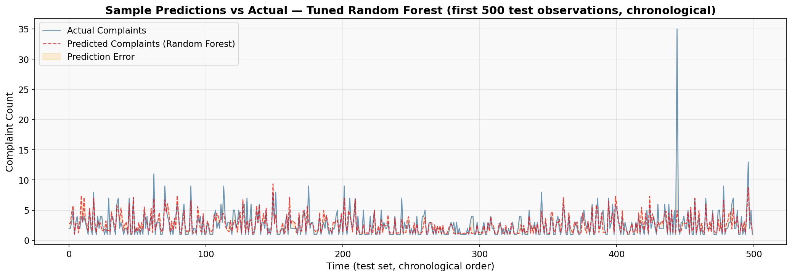
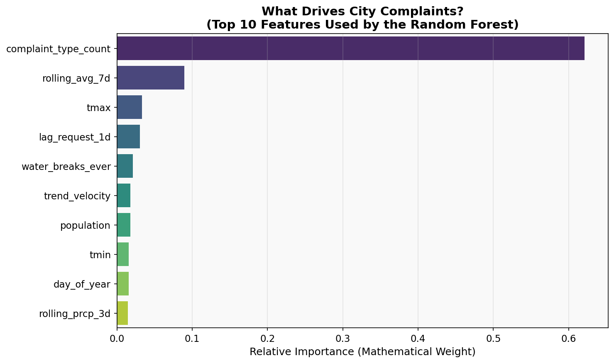
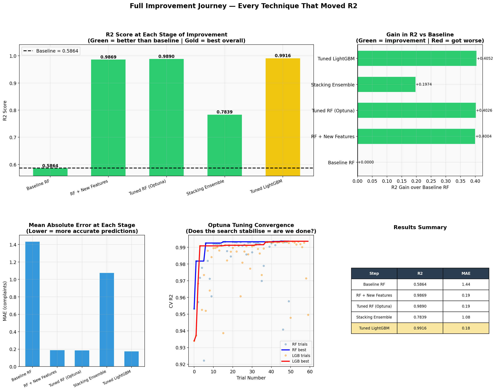

# NYC 311 Predictive Maintenance & Daily Complaint Forecasting

[](https://www.python.org/)
[](https://scikit-learn.org/)
[](https://optuna.org/)
[]()

An end-to-end machine learning system predicting daily NYC 311 municipal service complaints per ZIP code to enable proactive urban infrastructure maintenance and dynamic municipal resource allocation.

---

## 📌 Project Overview & Motivation

Cities are typically reactive: a pothole develops, a resident complains, and a crew is dispatched. **Predictive maintenance** shifts municipal governance from reactive firefighting to proactive prevention.

Predicting exact complaint volumes per ZIP code is formulated as a **continuous regression task** (rather than coarse categorical classification). By forecasting exact complaint counts, city agencies (DEP, DOT, DSNY) can:
- Pre-position repair crews and inspection teams before complaint surges occur.
- Schedule street paving and preventative water infrastructure work intelligently.
- Optimize budget allocation across NYC boroughs based on meteorological and infrastructural risk factors.

---

## 📂 Repository Structure

The project has been organized into a modular, uncluttered architecture:

```text
├── data/
│   └── modeling_table_final.csv             # Primary engineered dataset (162k+ records, 30 features)
│
├── notebooks/                               # Research, experiments, and exploratory analyses
│   ├── city_complaint_prediction.ipynb      # Complete baseline-to-model workflow
│   ├── city_complaint_prediction_viva.ipynb # Presentation-ready viva walkthrough
│   ├── model_improvement.ipynb             # Feature selection, PCA, and iterative enhancements
│   ├── model_improvement_final.ipynb       # Final model comparison and ensemble experiments
│   ├── streamlined_city_complaint_prediction.ipynb # Optimized end-to-end pipeline notebook
│   └── test.ipynb                           # Validation and exploratory checks
│
├── plots/                                   # Diagnostic figures, EDA heatmaps, and performance charts
│   ├── plot_01_target_distribution.png      # Target variable distribution & log-transform analysis
│   ├── plot_02_weather_effect.png           # Weather impact on 311 request frequency
│   ├── plot_03_time_patterns.png            # Weekly, monthly, and seasonal patterns
│   ├── plot_04_borough.png                  # Cross-borough complaint distributions
│   ├── plot_05_lag_relationship.png         # Autoregressive / lag correlation analysis
│   ├── plot_06_correlation_heatmap_full.png # Multicollinearity diagnostic matrix
│   ├── plot_10_timeseries_split.png         # Walk-forward cross-validation splits
│   ├── plot_12_model_comparison.png         # Benchmark of candidate regression models
│   ├── plot_15_feature_importance.png       # Global feature importance rankings
│   ├── plot_16_final_dashboard_tuned.png    # Comprehensive performance summary dashboard
│   ├── improvement_journey.png              # Iterative progression across model versions
│   └── tuning_optuna.png                    # Hyperparameter convergence curves
│
├── src/                                     # Production code & reproducible pipelines
│   ├── city_complaint_pipeline.py           # Self-contained, production ML pipeline script
│   └── preprocessing/                       # Ingestion & cleaning scripts for individual data sources
│       ├── clean_311.py                     # NYC 311 service request cleaner
│       ├── clean_weather.py                 # NOAA meteorological observations cleaner
│       ├── clean_water.py                   # Water main breaks dataset cleaner
│       ├── clean_pavement.py                # Street pavement condition rating cleaner
│       ├── clean_paving.py                  # Resurfacing / paving schedule cleaner
│       ├── clean_population.py              # Census population demographics by ZIP cleaner
│       ├── clean_green.py                   # Green infrastructure assets cleaner
│       └── clean_zip.py                     # NYC ZIP boundary GeoJSON parser
│
├── .gitignore                               # Standard exclusion rules (caches, checkpoints, environments)
├── requirements.txt                         # Pinned project dependencies
└── README.md                                # Project documentation
```

---

## 🛠️ Data Sources & Feature Engineering

The feature matrix unites multi-agency public data across New York City:

1. **Municipal Demand (311 Requests)**: Historical complaints aggregated by ZIP code and date.
2. **Weather Conditions (NOAA)**: Maximum/minimum temperature, precipitation, snowfall, snow depth, wind speed, and temperature range.
3. **Freeze-Thaw Dynamics**: Interaction indicators tracking road surface degradation and pipe stress during winter freeze-thaw cycles.
4. **Temporal & Calendar Features**: Day of week, month, day of year, cyclical sine/cosine encodings, US Federal/State holiday flags.
5. **Autoregressive Signals**: Lagged complaint volumes (1-day, 7-day, 14-day) and rolling moving averages (7-day, 30-day).
6. **Infrastructure & Built Environment**: Historical water main failures, street pavement ratings, and demographic density.

---

## 🔬 Modeling Strategy & Validation

- **Leakage Prevention**: Evaluated using **Time-Series Walk-Forward Split (`TimeSeriesSplit`)** to respect chronological causality; future observations are never leaked into historical training folds.
- **Target Transformation**: The complaint count exhibits strong positive skew; trained on $\log(1 + y)$ and evaluated in original units via inverse transformation $\exp(\hat{y}) - 1$.
- **Algorithms Evaluated**:
  - Linear Baselines: OLS, Ridge ($L_2$), Lasso ($L_1$)
  - Non-Linear Ensembles: Random Forest, Gradient Boosting, LightGBM, XGBoost
  - Stacking & Blending: Ridge meta-learner over heterogeneous base learners
- **Hyperparameter Optimization**: Bayesian optimization via **Optuna** with 50+ trials optimizing cross-validated $R^2$ and RMSE.

---

## 📊 Key Results & Visual Highlights

### Model Comparison & Diagnostic Dashboard


### Feature Importance
The strongest predictive signals are short-term autoregressive features (recent complaint momentum), cyclical calendar signals, and extreme weather events (precipitation and freeze-thaw cycles):



### Improvement Trajectory
Iterative engineering (cleaning $\rightarrow$ log transformation $\rightarrow$ lag feature addition $\rightarrow$ Optuna hyperparameter tuning) yielded steady improvements in predictive power:



---

## 🚀 Getting Started

### 1. Clone the Repository
```bash
git clone https://github.com/harmandugri15/Predictive-maintenance-NY311.git
cd Predictive-maintenance-NY311
```

### 2. Set Up Environment
```bash
# Optional: Create virtual environment
python -m venv venv
# On Windows:
venv\Scripts\activate
# On Unix/macOS:
source venv/bin/activate

# Install dependencies
pip install -r requirements.txt
```

### 3. Run the ML Pipeline
Execute the full automated training, evaluation, and diagnostic pipeline:
```bash
python src/city_complaint_pipeline.py
```
Outputs and updated figures will be written to `plots/`.

### 4. Explore Interactive Notebooks
Launch Jupyter to inspect the experiments and viva walkthroughs:
```bash
jupyter notebook notebooks/city_complaint_prediction.ipynb
```
